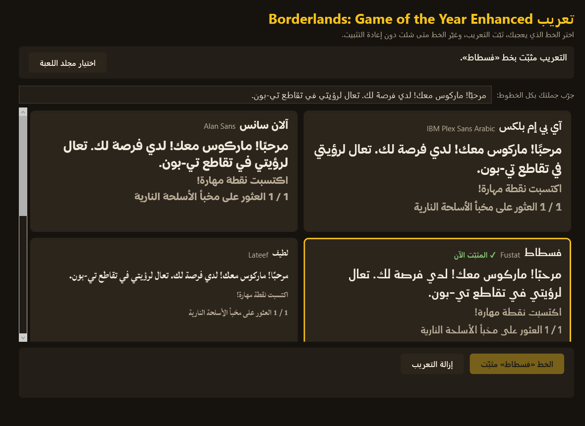
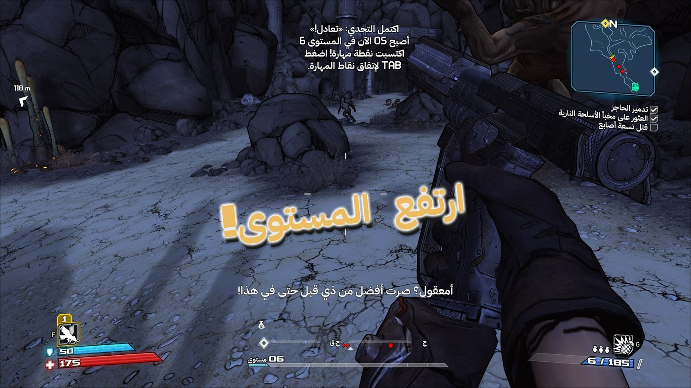
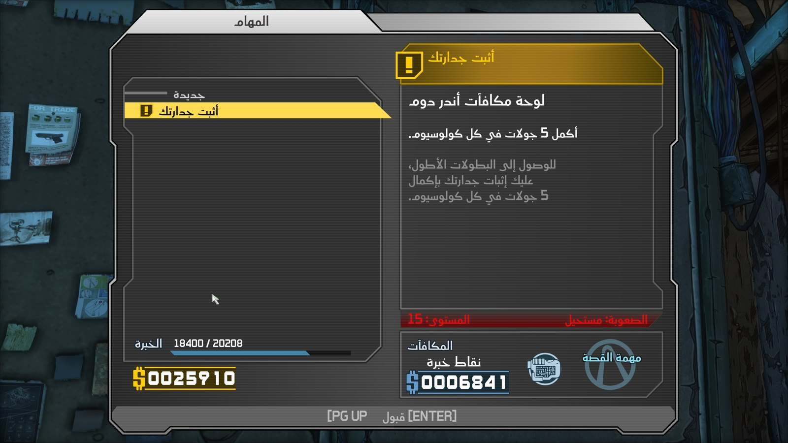
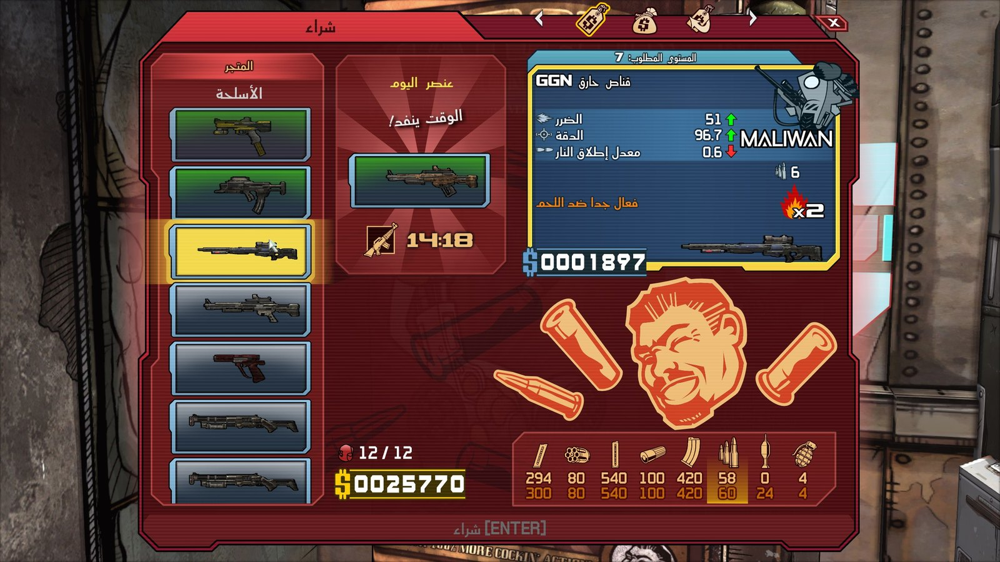
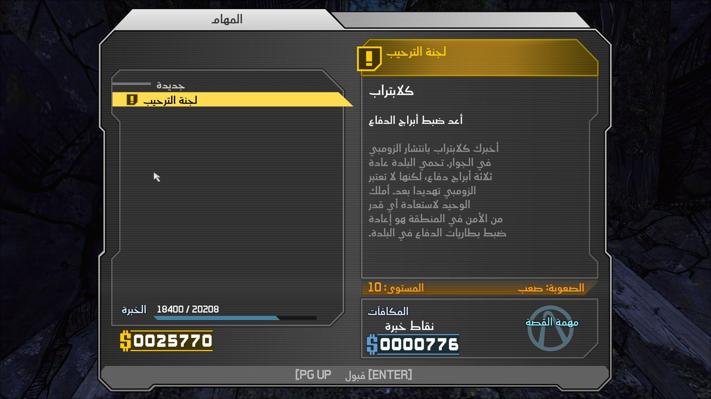

# تعريب Borderlands: Game of the Year Enhanced | Borderlands GOTY Enhanced Arabic

تعريب كامل لـ Borderlands: Game of the Year Enhanced على Steam، للعبة الأساسية والإضافات الأربع: الحوارات والترجمة النصية، القوائم والإعدادات، المهمات، شاشات التحميل، الأسلحة والأعداء والمهارات، وبرنامج تشغيل اللعبة. التعريب يحل محل الإنجليزية.

## اللي تحتاجه

1. نسخة Steam من اللعبة، رقم البناء **9171464**.
2. لغة اللعبة في Steam: **English**.
3. نحو 5 غيغابايت فاضية على قرص اللعبة.

## التثبيت

1. سكّر اللعبة. حمّل `BorderlandsGOTY-Arabic-1.0.zip` من [Releases](../../releases/latest) وفك ضغطه كامل في أي مكان.
2. افتح `Borderlands Arabic.exe`. إذا ظهرت رسالة "Windows protected your PC"، اضغط More info ثم Run anyway.
3. يلقى البرنامج اللعبة عن طريق Steam، أو اختر مجلدها بنفسك.
4. قارن الخطوط السبعة، اكتب أي جملة لتشوفها بكل الخطوط، اختر خط واضغط «تثبيت التعريب».
5. شغّل اللعبة.

## تغيير الخط

افتح البرنامج في أي وقت، اختر خط ثاني واضغط «تغيير الخط». ما تحتاج تعيد التثبيت.

## الإزالة

افتح البرنامج واضغط «إزالة التعريب». ترجع الملفات الأصلية من مجلد `ArabicPatch-Backup` داخل مجلد اللعبة. ويمكنك أيضًا التحقق من ملفات اللعبة في Steam.

## بعد تحديث اللعبة

إذا حدّثت Steam اللعبة قد يتوقف التعريب حتى ينزل له تحديث. البرنامج يرفض التثبيت على ملفات ما يعرفها وما يغيّر شيء.

| | |
|---|---|
|  |  |
|  |  |

---

## English

Complete Arabic translation of Borderlands: Game of the Year Enhanced on Steam, for the base game and all four DLCs:
dialogue and subtitles, menus and settings, missions, loading screens, weapons, enemies and skills, and the game's
launcher. The Arabic replaces English.

### What you need

1. The Steam version of the game, build **9171464**.
2. Game language in Steam: **English**.
3. About 5 GB free on the game drive.

### Install

1. Close the game. Download `BorderlandsGOTY-Arabic-1.0.zip` from [Releases](../../releases/latest) and extract all of it anywhere.
2. Open `Borderlands Arabic.exe`. If "Windows protected your PC" appears, click More info, then Run anyway.
3. It finds the game through Steam, or pick its folder yourself.
4. Compare the seven fonts, type any sentence to see it in all of them, pick one and press Install.
5. Start the game.

### Change the font

Open the program any time, pick another font and press Change font. No reinstall needed.

### Uninstall

Open the program and press Remove. The original files come back from `ArabicPatch-Backup` inside the game folder. Steam's
"Verify integrity of game files" also restores them.

### After a game update

If Steam updates the game, the translation may stop working until it is updated. The program refuses to install over files
it does not know and changes nothing.

### Fonts

IBM Plex Sans Arabic, Alan Sans, Fustat, Lateef, Lemonada, Playpen Sans Arabic and Zain, all under the SIL Open Font License
1.1. The licence texts are in `licenses/` and next to each font in `payload/fonts`.

All my translations: https://iosamai.com
